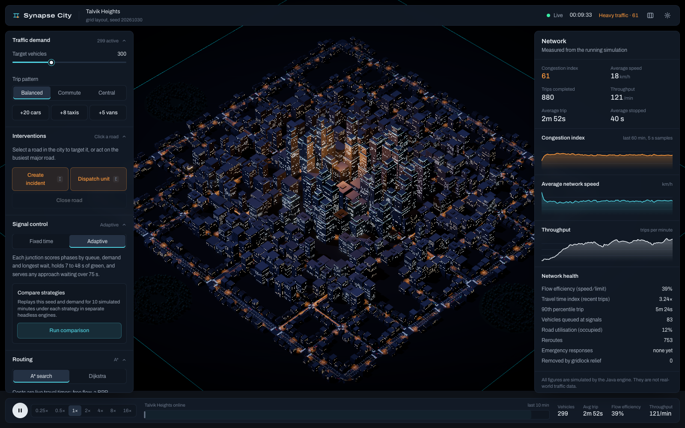
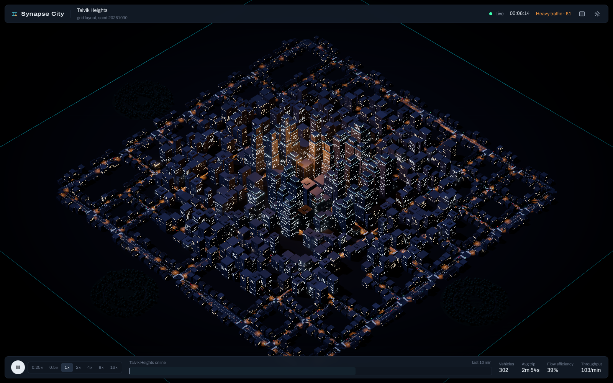
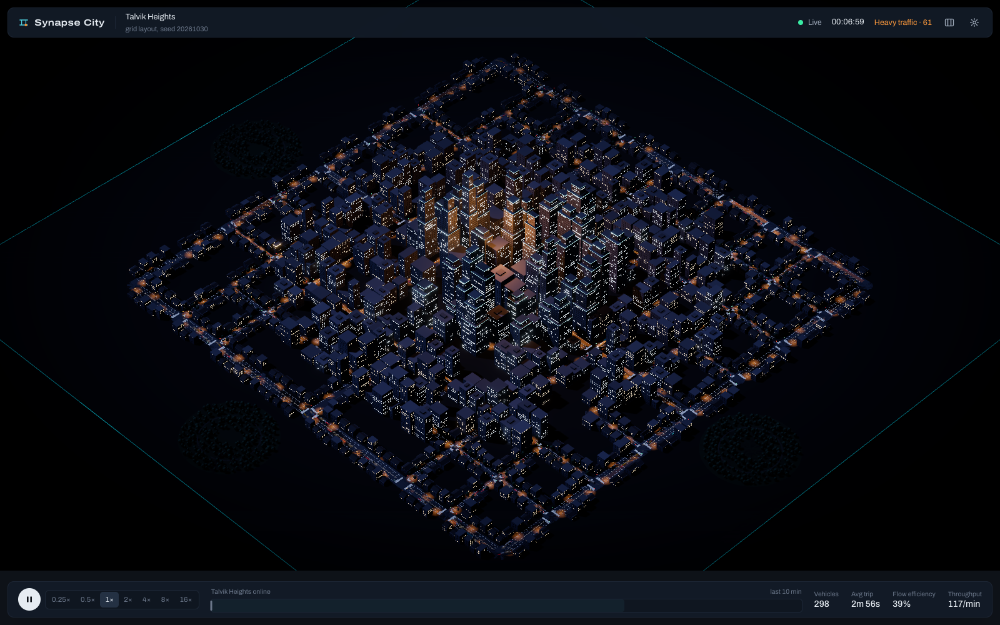
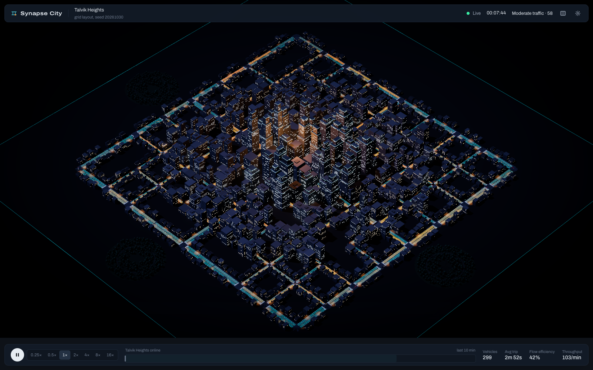
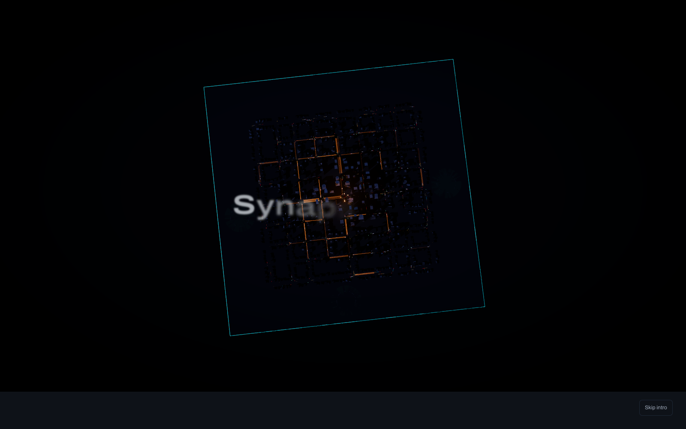

# Synapse City

A deterministic urban traffic simulation written in Java, rendered live as a miniature night-time city in the browser.

**[Open the live demo](https://yoonmax.github.io/synapse-city/)**. Nothing to install: the Java simulation runs in your browser, and every visitor gets a private city. Best on a desktop browser with WebGL.

The Java engine is the only place where anything is decided: it generates the city, routes every vehicle with Dijkstra or A*, runs Intelligent Driver Model car-following, reserves junction space, controls traffic signals with fixed-time or adaptive logic, and records every metric. The React and Three.js client draws what the engine sends and forwards user commands back to it. The engine runs and tests independently of Spring and of the browser.



| | |
|---|---|
|  |  |
|  |  |

Screenshots are captured from the running application with `scripts/capture-screenshots.sh` (headless Chrome). There is no demo video yet.

## What you can do

- Watch a seeded city (grid, radial or organic street plan) fill with cars, taxis, buses, delivery vans and emergency units.
- Click any vehicle to see its current decision ("Red signal at junction 73: stopping at the line"), its decision log, its remaining A* route drawn above the street, and the search statistics behind that route.
- Click a junction to see its signal phase, time left in the stage, per-approach queues and the adaptive controller's pressure scores.
- Click a road to close it, crash a car on it, or send an emergency unit there, then watch vehicles replan.
- Switch between fixed-time and adaptive signals, or run a side-by-side comparison of both on the same seed in two headless engines.
- Load reproducible scenarios: Rush Hour, Gridlock, Emergency, Road Failure, Smart Signals.
- Regenerate the city from any seed, change demand and trip patterns, switch routing between A* and Dijkstra, and run at 0.25× to 16×.

## Stack

| Layer | Technology |
|---|---|
| Simulation | Java 21, no framework dependencies (`com.synapsecity.simulation.*`) |
| Server | Spring Boot 3.5, raw WebSocket (binary + JSON), REST |
| Tests | JUnit 5, Spring Boot Test (89 tests), plus JVM-vs-JavaScript parity checks |
| Browser build | TeaVM 0.16 compiles the same Java to JavaScript, run in a Web Worker |
| Client | React 19, TypeScript, Vite 7, Three.js r180, React Three Fiber 9, Drei, postprocessing, GSAP, Tailwind CSS 4, Zustand |

## Architecture

```
┌──────────────────────────── Java (authoritative) ─────────────────────────────┐
│                                                                              │
│  simulation/roads      CityGenerator → RoadGraph (nodes, roads, directed     │
│                        segments), buildings, parks, lights, bus stops        │
│  simulation/routing    Dijkstra, A*, congestion-aware TravelTimeCostModel    │
│  simulation/agents     Vehicle state machine, IDM dynamics, FleetManager     │
│  simulation/signals    Intersection (phases, box reservation), controllers   │
│  simulation/events     bounded EventLog                                      │
│  simulation/metrics    trip records, live metrics, 5 s time series, perf     │
│  simulation/scenarios  presets + scripts, ComparisonRunner, HeadlessRunner   │
│  simulation/core       SimulationEngine (fixed 0.1 s step), clock, config    │
│                                                                              │
│  session/              pacing, commands, messages; shared by both hosts      │
│  api/SimulationService   server host: one "sim-loop" thread owns the engine  │
│  browser/BrowserMain     demo host: same session in a Web Worker (TeaVM)     │
│  websocket/protocol      command parser, wire messages, binary frame encoder │
└───────────────┬──────────────────────────────────────────▲───────────────────┘
                │ binary frame ≤20 Hz (vehicles, signals,   │ JSON commands
                │ congestion) + JSON state 2 Hz + details   │ (validated, rate-limited)
┌───────────────▼──────────────────────────────────────────┴───────────────────┐
│  network/     typed protocol mirror, decoder, reconnecting client             │
│  state/       Zustand store + non-reactive two-frame interpolation buffer     │
│  city/        renderer, geometry, vehicles, camera, effects (R3F, instanced) │
│  ui/          controls, inspector, analytics                                  │
└───────────────────────────────────────────────────────────── TypeScript ─────┘
```

### Two hosts, one engine

The live demo and the server run the same Java classes. `SimulationSession` holds the logic for pacing the engine, applying commands and building messages, with no threads, networking or server dependencies. `SimulationService` hosts it on the JVM and serves it over a WebSocket. `BrowserMain` hosts it in a Web Worker after TeaVM compiles it to JavaScript. Both send identical messages, so the client has one code path and only the transport differs.

The compiled engine is not an approximation. `scripts/check-browser-parity.sh` runs the same configuration on the JVM and as JavaScript and compares a hash of the complete simulation state (every vehicle's position, speed and state, and all signal timing). All four configurations it covers, across all three layouts and up to 900 vehicles, match exactly after 300 simulated seconds.

Hosting the demo this way costs nothing, never sleeps, and gives each visitor their own simulation. On the server, by contrast, all clients share one.

### Threading and determinism

Exactly one thread mutates the engine. WebSocket and REST threads only enqueue work; the loop drains the queue between whole steps, advances the engine by however many fixed 0.1 s steps the wall clock and speed multiplier call for (capped per tick), then publishes. The engine never reads the wall clock, all randomness comes from one seeded `SplittableRandom` consumed in a fixed order, and every collection is iterated in id order. Two engines with the same configuration and the same commands at the same ticks produce identical state hashes; the test suite checks this tick by tick. On the server, comparisons run on a separate thread in independent engine instances, so they cannot disturb the live run. The browser build has one worker thread, so its live city pauses for a few seconds during a comparison.

### Wire protocol

Positions change every tick, so they travel as a 20-byte-per-vehicle little-endian binary frame: id, x, y, quantised heading, speed, type, state, flags, fade and lane, followed by one congestion byte per segment and one signal-colour byte per approach. 500 vehicles on a 266-segment city is about 10.6 kB. The client keeps the last two frames and interpolates between them at render rate, so rendering is decoupled from network and simulation rates. Slow state (metrics, events, incidents) goes out as JSON at 2 Hz; inspector details go only to the client that asked, at 4 Hz. Message types are defined once in `websocket/protocol/Messages.java` and mirrored in `frontend/src/network/protocol.ts`.

## The simulation

### City generation

`CityGenerator` builds a street sketch for the chosen layout, carves a fraction of local streets, prunes dead ends, keeps only the largest connected component, then freezes the result into a `RoadGraph`. Every two-way road becomes two directed `RoadSegment`s with an id, endpoints, inset lane geometry, length, speed limit, lane count, jam-density capacity, live load, smoothed observed speed and a travel-time estimate. Buildings are placed along street frontages with oriented-rectangle collision tests against roads, junctions, parks and each other. Height and massing (towers with setbacks downtown, mid-rise offices and flats, houses on the outskirts) follow distance from the centre. Tests assert that all three layouts are strongly connected for several seeds and that the same seed reproduces the same city exactly.

### Routing

Both algorithms run over the directed segment graph with a binary heap and deterministic tie-breaking:

- **Dijkstra** settles nodes in cost order and stops when the goal is settled.
- **A\*** orders by g + h, where h = straight-line distance / fastest speed limit in the network.

Edge cost is travel time:

```
t_free = graphLength / effectiveSpeedLimit                 (incidents lower the limit)
t_bpr  = t_free · (1 + 0.15 · (load / practicalCapacity)^4)  (BPR volume-delay curve)
t_obs  = graphLength / smoothedObservedSpeed
cost   = t_free + w · max(0, max(t_bpr, t_obs) − t_free) + 3 s at signalised junctions
```

Closed roads cost infinity. Every term is at least `graphLength / maxSpeed`, and routing uses centre-to-centre lengths, so the heuristic is admissible and consistent. The suite checks on 600 random origin–destination pairs across all layouts that A* returns exactly Dijkstra's cost while settling no more nodes. `w` is 1 for normal traffic and 2.5 for emergency units, which steer around queues more aggressively.

Vehicles replan when a road on their route closes (forced), every 20 s if their sampled "reroute awareness" says so (they switch only for a 15% + 3 s saving, which prevents flapping), and when stopped for more than 45 s. The inspector shows the algorithm, nodes explored, search time in microseconds, planned distance and cost, and route changes, all taken from the Java `RouteResult`.

### Vehicles

Each vehicle has an id, type, lane-based position (segment, lane, `s`) or junction position (connector, `cs`), route and route index, destination, speed, acceleration, a sampled driver profile (desired-speed, headway and acceleration factors) and a validated state machine:

`SPAWNING → CRUISING ⇄ APPROACHING_INTERSECTION ⇄ WAITING_AT_SIGNAL → CROSSING_INTERSECTION → … → ARRIVING → DWELLING / DESPAWNING`, with `REPLANNING` as a transient state. Illegal transitions throw, and long multi-layout test runs prove the engine only takes legal ones.

Longitudinal control is the Intelligent Driver Model (Treiber et al., 2000). The obstacle each vehicle reacts to is its lane leader, a virtual stopped car at the stop line (red, amber with room to stop, crossing traffic, a full exit lane), its destination, or the last vehicle on the exit lane seen through the junction once entry is granted. Car type parameters (length, acceleration, comfortable deceleration, headway, minimum gap) differ for cars, taxis, buses, vans and emergency units. Taxis take new fares, buses loop through stops with dwell times, vans make two deliveries.

### Junctions and signals

Approaches with roughly opposite directions (more than 130° apart) share a phase; the rest get their own. Every phase change goes green → amber (3 s) → all-red (1.5 s), so at most one phase is ever non-red. Tests check this invariant every tick under 900 vehicles on every layout.

Before entering a junction, a vehicle must reserve it. A reservation is granted only if the signal allows it, no conflicting movement is reserved or inside the box, and the exit lane has room for the whole vehicle, so junctions cannot be blocked from inside. Conflicts are computed per lane-to-lane movement: merges, crossing paths from the same approach, a turn across oncoming traffic, and crossing approaches (unless both turn right). Unsignalised junctions give way to whoever has waited longest.

**Fixed-time** control serves phases in order with 24 s greens for phases carrying an arterial or collector and 15 s otherwise, offset by x-position to create an eastbound green wave.

**Adaptive** control scores each phase every tick:

```
pressure(p) = Σ over approaches in p of  queue + 0.35 · detected + longestWait / 8
```

It holds at least 7 s of green, holds green if no other phase has demand, ends green early when the phase runs dry, switches when another phase's pressure exceeds 1.3× the current one plus 1.5, caps green at 48 s, and serves any phase whose demand has waited over 75 s first. A test runs 650 vehicles for 10 minutes and checks that no approach with demand waits longer than the bound these rules imply.

**Emergency priority**: a unit within 160 m of a signalised junction requests its approach's phase. The controller still clears through amber and all-red (after at least 2 s of the current green), holds the phase while the request is refreshed, and releases it when the unit passes. Units obey reservations like everyone else. Response time is measured from dispatch to arrival.

### Metrics

All numbers come from engine state or from recorded trip completions, never synthesised:

- **Congestion index** = 100 · (1 − Σ speed / Σ posted limit) over vehicles on the road. It counts red-light stops and turn slowdowns, so an almost empty signalised grid already scores about 35. The condition bands are calibrated to that: free flow below 45, moderate below 60, heavy below 75, severe above.
- **Travel time index** = actual trip time / free-flow trip time, averaged over recent trips.
- Trip time, time stopped, 90th percentile, throughput, queues at signals, road utilisation, reroutes, emergency response times, and vehicles removed by gridlock relief.

The time series is sampled every 5 simulated seconds and can be exported from the settings menu (or `GET /api/metrics/series.csv` on the server). Every figure in the UI is simulated output, not real-world traffic data.

## Measured performance

Measured on an Apple M4 Pro (Temurin 21.0.13), single simulation thread, 600 simulated seconds per run, with `HeadlessRunner`:

| Vehicles (grid) | Mean step | p95 step | Real-time factor | Routing call | Nodes explored |
|---|---|---|---|---|---|
| 300 | 45 µs | 54 µs | 1,410× | 3.2 µs | 16.9 |
| 600 | 79 µs | 102 µs | 1,013× | 3.1 µs | 20.5 |
| 900 | 122 µs | 192 µs | 729× | 3.4 µs | 22.0 |

The spacing safety net (which pushes back any vehicle that would overlap its leader) recorded 0 interventions in all three runs. Occasional single-step maxima of 5 to 6 ms are JIT warm-up and GC.

The compiled JavaScript engine averages about 240 µs per step at 300 vehicles and 545 µs at 900 in Node. In Chrome, in a background-throttled pane (the only browser reading taken so far), it averaged 1.7 ms at about 300 vehicles. Real time needs 100 ms per step, so even that leaves ample headroom. Sustained rates on a foreground page have not been measured.

Rendering: one full scene pass including the shadow map, measured by calling `renderer.render` synchronously 20 times in Chrome at 2880×1800, took 1.1 ms with 50 draw calls and 122k triangles (default grid city, about 300 vehicles; post-processing not included). I have not measured sustained in-browser frame rate on a visible window; the in-app performance overlay (`P`) reports measured fps, draw calls, triangles, server step cost and snapshot size so you can check it on your hardware. If frame rate stays between 8 and 32 fps for 4 s, the client switches itself to performance mode.

### Fixed-time vs adaptive signals

Same seed, demand and script; 600 simulated seconds each (`HeadlessRunner compare <PRESET> 600`):

| Scenario | Strategy | Trips | Avg trip | Avg stopped | Mean congestion | Peak queue | Removed by gridlock relief |
|---|---|---|---|---|---|---|---|
| Smart Signals (520 veh) | Fixed | 759 | 243.3 s | 113.0 s | 77.1 | 308 | 1 |
| | Adaptive | 909 | 229.3 s | 93.1 s | 73.4 | 286 | 0 |
| Rush Hour (560→680 veh) | Fixed | 789 | 250.5 s | 125.9 s | 80.7 | 452 | 7 |
| | Adaptive | 940 | 235.5 s | 102.8 s | 76.9 | 393 | 2 |
| Emergency (480 veh) | Fixed | 831 | 236.3 s | 103.3 s | 73.3 | 269 | 0 |
| | Adaptive | 928 | 222.1 s | 80.6 s | 69.8 | 237 | 0 |
| Gridlock (760 veh) | Fixed | 596 | 283.2 s | 162.7 s | 85.0 | 527 | 23 |
| | Adaptive | 619 | 293.8 s | 162.8 s | 82.5 | 492 | 13 |

In the first three scenarios adaptive control completes 12–20% more trips, cuts time stopped by 18–22%, and shortens the average trip by about 6%. Gridlock is the exception. There the network is saturated: adaptive completes 4% more trips and removes fewer deadlocked vehicles, but time stopped does not change and the average completed trip is 3.8% longer.

In the Emergency scenario the average emergency response was 95 s under adaptive control and 193 s under fixed time. That average covers only the scripted units in one run, so treat it as an example, not a general result; an earlier version of the model, with different random draws, had adaptive slower. These are results from this model only.

## Running it

Prerequisites: JDK 21+, Maven 3.9+, Node 20+.

```bash
cd backend && mvn spring-boot:run
```

```bash
cd frontend && npm install && npm run dev
```

Open http://localhost:5173. Vite proxies `/api` and `/ws` to the backend on port 8080. Add `?intro=skip` to skip the opening sequence; `panels=0`, `heat=1` and `cam=x,y,fov` are also available for demos.

### Docker Compose

```bash
docker compose up --build
```

This builds the backend jar and the static client and serves the client through nginx on http://localhost:5173, proxying API and WebSocket traffic to the backend. The Dockerfiles have not yet been built in the development environment used for this project (Docker was not installed there), so treat this path as untested.

### Static build (the live demo)

```bash
scripts/build-pages.sh
```

This compiles the engine with TeaVM and builds the client into `frontend/dist-pages`. `scripts/deploy-pages.sh` builds it and publishes it to the `gh-pages` branch, which GitHub Pages serves at https://yoonmax.github.io/synapse-city/.

### Headless runs

The simulation needs neither Spring nor a browser:

```bash
cd backend && mvn -q compile
java -cp target/classes com.synapsecity.simulation.scenarios.HeadlessRunner GRID 600 600
java -cp target/classes com.synapsecity.simulation.scenarios.HeadlessRunner compare RUSH_HOUR 600
```

`POST /api/experiments/compare/{SCENARIO}?seconds=600` runs the same comparison over HTTP.

## Tests

```bash
cd backend && mvn test
```

89 tests, all passing at the time of writing:

- **Graph**: directed segment construction, inset geometry, right-hand lane placement, frozen topology, strongly connected components on disconnected and one-way networks, closures.
- **Routing**: hand-computed shortest paths, closures and forbidden first edges, unreachable destinations, start equals goal, and A* vs Dijkstra cost equality plus node-count reduction on 600 random pairs across all layouts.
- **Generation**: same-seed reproducibility, seed sensitivity, strong connectivity for four seeds per layout, valid segment attributes, buildings never sitting on roads.
- **State machine**: legal trip sequence, illegal transitions, terminal despawn.
- **Engine**: exact fixed stepping, zero demand, tick-by-tick reproducibility with commands, reset, and 900 vehicles on every layout with per-tick checks for overlaps, conflicting junction reservations, signal safety and contiguous routes.
- **Closures**: affected vehicles stop planning through a closed road; reroutes are counted.
- **Signals**: phase pairing, fixed-time amber/all-red sequencing and splits, adaptive hold without demand, and a starvation bound under heavy load.
- **Emergency**: dispatch, preemption without breaking signal safety, arrival and response time, and congestion-weighted routing costs.
- **Metrics**: aggregation, percentiles, travel time index, sampling interval, condition bands.
- **Scenarios**: every preset replays to the same state hash with every scripted step executed once; comparisons are deterministic and the two strategies really differ.
- **Protocol**: every command shape, 26 malformed or out-of-range payloads, oversized payloads, and a real WebSocket session against the booted server (handshake, city, binary frame layout, error replies, pause).
- **Browser portability**: the seeded generator's uniform draws match the JDK's SplitMix64 exactly, and the browser build's hand-written JSON matches Jackson's output for every message type on real simulation data.

Two scripts check the compiled browser build. `scripts/check-browser-parity.sh` compares full state hashes between the JVM and JavaScript. `node scripts/check-worker.cjs frontend/dist-pages/synapse-sim.js` drives the compiled worker with every command and checks each reply.

The client has a strict TypeScript build (`npm run typecheck`) but no automated UI tests yet.

## Design decisions

- **One authoritative engine thread, not concurrent agents.** Parallel vehicle updates would make results depend on scheduling. Synchronous IDM updates (all accelerations computed from one snapshot, then integrated) keep the result independent of iteration order, except for junction reservations, which are granted in a fixed order.
- **Lane-based 1D kinematics with explicit junction connectors.** Each vehicle moves along a lane or along a Bézier connector through the box. This makes car-following, queue detection and conflict checks exact and cheap, at the cost of no overtaking.
- **Reservations instead of collision detection.** Collisions are prevented by construction (exit-lane space and conflicting-movement checks) rather than detected afterwards. The overlap clamp exists as a last resort and is reported as a metric.
- **Binary frames for positions, JSON for everything else.** Positions dominate bandwidth; everything else is small, infrequent and easier to evolve as JSON.
- **Compile the engine to the browser instead of renting a server.** A public server would mean one simulation shared by every visitor (anyone could reset it for everyone) and a host that sleeps when idle. Running the same Java in a Web Worker avoids both, and the parity check proves it behaves identically.
- **Telephoto "isometric" camera.** The isometric mode is an 11° lens at long range, which approximates an axonometric view while keeping fog, shadows and picking identical to the perspective mode.

## Known limitations

- No lane changing or overtaking; lanes are chosen on entry to each segment from the next turn.
- Emergency vehicles cannot make traffic ahead pull aside; they rely on signal preemption to clear the queue in front of them.
- Pedestrians are not simulated; crosswalks are visual only.
- Vehicles stopped for more than 180 s are removed to break deadlocks (as in SUMO's teleport rule) and counted as "removed by gridlock relief".
- The congestion index includes signal delay by design; compare it between runs rather than against real-world indices.
- On the Java server, one shared simulation serves all connected clients. The live demo gives each visitor a private one, which is lost when the page closes.
- In the live demo, the city pauses for a few seconds during a strategy comparison.
- Docker Compose has not been verified.
